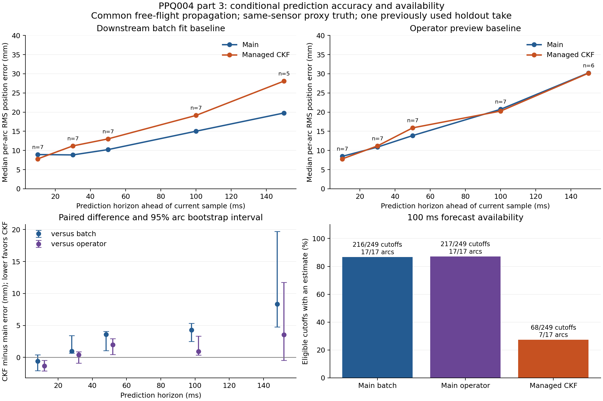

# PPQ004: managed CKF versus current upstream main

**The existing recordings do not demonstrate an overall accuracy advantage for
the managed CKF.** At the preselected 100 ms forecast horizon, paired results
favor main's batch fit and, more narrowly, its operator preview fit. Managed CKF
forecast availability is substantially lower. Native contact-plane accuracy
remains inconclusive because only one holdout arc has paired predictions.

This is a completed offline comparison, not a completed full-system qualification.
No planner runtime, physics coefficients or admission thresholds were changed.

## Exact implementations and data

* Latest upstream [hitchopen/HOPE/main at 01de418](https://github.com/hitchopen/HOPE/commit/01de418c146cf3f2d2dba32e63b425f01c8a7f19), checked against GitHub on November 14, 2026.
  The fork's older main branch is not substituted for this baseline.
* Our [recorded-validation implementation at f490202](https://github.com/timothyypark/HOPE/commit/f4902023d49c85ff57da62a618b2001181d3b8e7).
* Comparison rules, native adapters and scorer were committed and pushed at
  [f6c33a4](https://github.com/timothyypark/HOPE/commit/f6c33a4) before replaying recordings.
  Plotting, availability diagnostics and reproduction documentation were added
  at [9e5b0d7](https://github.com/timothyypark/HOPE/commit/9e5b0d7); scoring rules were unchanged.
* All 146,931 source frames from PPQ004 parts 1–3, including missing observations;
  102,275 frames have tracked ball positions. Existing screened incoming arcs:
  151 development arcs in parts 1–2 and 17 benchmark holdout arcs in part 3.
* Prepared observations SHA-256:
  `6dccb4fd32f630e4ddb89aa56796a150156ea01c67e1ff4b6560ed319e82ab30`.
  Full source, binary, profile and output hashes are in [receipt.json](replay/receipt.json).

Replay runs once per complete take and implementation, in original chronological
order. Queries occur every 20 ms at identical source cutoffs. Original recorded
orientation is supplied when qualified; future fitted spin and annotation
boundaries never enter the predictors. The virtual clock expires observations
through gaps. Annotations are used only after replay for scoring.

## What the baselines mean

`main_operator` reproduces the actual `LaptopPlayState` observation admission,
generation/bounce resets, and its dedicated operator preview estimator settings:
100 ms fit window, 60 ms minimum span, eight samples, single-flight fitting.
Native plane queries use the production `FutureContactPredictor` class. This is
a diagnostic of its fitted state and predictor, not the operator GUI's advisory
forecast drawing, adaptive packet commit schedule or receiving planner execution.

`main_batch` uses the downstream hardware-profile production batch and spin
estimators continuously, with a 180 ms window, 80 ms minimum span and 24 samples,
without operator admission. It is a useful continuous fit baseline but does not
reproduce the sparse one-shot packet path. Keeping this separate exposes the
effect of admission and different preview settings.

`v2_managed` uses the actual persistent `V2IncomingCoordinator`, continuous
forecast and strike adapter with existing defaults, a stable reference fixture
and explicit fixed query planes. No annotation START/CONTEXT/CONTACT commands
are injected. The resulting comparison includes lifecycle and spin differences;
it is not an isolated mathematical CKF-versus-batch-filter experiment.

## Primary 100 ms result

Here, **100 ms means 100 ms after the latest supplied ball observation**, not
100 ms after net crossing and not processing latency. Each estimated position,
velocity and effective spin is propagated through identical free-flight RK4
physics, without an intervening contact, and compared with the future measured
ball position. This isolates predictive estimated-state quality under common
propagation; it does not replace the native contact prediction comparison below.

Errors are RMS within each matched arc, followed by equal-weight arc summaries.
Each pair uses exactly the same arc, source cutoff and future observation.

| Holdout comparison | Matched arcs / cutoffs | Main median arc RMS | CKF median arc RMS | Median paired CKF-minus-main difference | 95% arc bootstrap interval |
|---|---:|---:|---:|---:|---:|
| Downstream batch fit | 7 / 58 | 15.02 mm | 19.14 mm | +4.28 mm | +2.51 to +5.34 mm |
| Operator preview fit | 7 / 63 | 20.74 mm | 20.27 mm | +0.92 mm | +0.34 to +3.33 mm |

Six of seven paired arcs favor main in each comparison. The operator row's two
separate medians appear to favor CKF slightly, but subtracting those medians
does not preserve pairing. Comparing each arc against itself and then taking
the median yields the positive 0.92 mm difference shown above. All per-arc
values are retained in [results.json](scores/results.json).

CKF does show a short-horizon advantage against the operator preview at 10 ms:
median paired difference −1.33 mm, interval −2.12 to −0.48 mm. At 30 ms that
comparison is unclear; at 50 and 100 ms it favors main. Against the batch fit,
the holdout paired differences favor main at 30–150 ms; the 10 ms interval
includes zero. Development 100 ms differences include zero for both baselines.
This variation is another reason not to claim a universal algorithm winner.

These bootstrap intervals describe the observed arcs in one previously used
holdout recording. They do not establish independent cross-session significance.
Other horizons are declared diagnostics, not substitutes for the primary result.

## Availability must accompany accuracy

The holdout has 249 eligible 100 ms cutoffs across 17 incoming arcs.

| Method | Cutoffs with available estimated state | Arcs with at least one output |
|---|---:|---:|
| Main downstream batch fit | 216 / 249 (86.7%) | 17 / 17 |
| Main operator preview | 217 / 249 (87.1%) | 17 / 17 |
| Managed CKF | 68 / 249 (27.3%) | 7 / 17 |

Availability here is forecast-state availability, **not issued commands**.
Missing outputs remain missing and never contribute zero error. Conditional
accuracy is calculated only on common support; each method's own-support
errors, unmatched cutoffs and denominators are also retained.

Of the CKF's 181 unavailable holdout cutoffs, 151 carry
`qualified_non_ballistic_motion`, 22 carry
`acquisition_qualified_spin_model_residual`, six are still collecting spin and
two lack a supported unknown-spin model. These are actual returned state/model
reasons, not inferred numerical-filter failures. The production residual checks
compare observed curvature with expected acceleration; the existing annotations
do not establish legal-play history and cannot alone prove these refusals wrong.
See [availability-reasons.json](scores/availability-reasons.json).

The ungated batch baseline has large own-support tail errors (holdout arc RMS
95th percentile 424.75 mm), while the operator preview's corresponding figure
is 31.04 mm. Those distributions cover different supports from CKF's, so they
are not a fair accuracy ranking. They reinforce why the ungated fit is only a
diagnostic baseline and why pairing and lifecycle coverage both matter.

## Native receiving-plane result

The preselected receiving plane is x=0.15 m in the original table-corner frame.
Truth is a unique crossing bracketed by adjacent measured samples inside an
incoming screened arc. Predictions are queried 10–500 ms before that crossing.
At 300 Hz the measured time bracket is approximately 3.33 ms; timing error
outside that bracket is retained separately.

Only two holdout arcs cross this plane within the scoring bounds, yielding
43 eligible cutoffs. Main operator supplies 40 targets across both arcs, main
batch 37 across both, and V2 supplies 22 across one arc.

| Paired native comparison | Paired arcs / cutoffs | Main position RMS | CKF position RMS | Main arrival-time RMS | CKF arrival-time RMS |
|---|---:|---:|---:|---:|---:|
| Operator preview | 1 / 20 | 18.72 mm | 24.19 mm | 21.71 ms | 19.93 ms |
| Downstream batch fit | 1 / 19 | 14.86 mm | 24.40 mm | 17.35 ms | 12.98 ms |

These are descriptive one-arc results: CKF position error is larger and timing
error smaller on that arc. **There is insufficient paired support to decide
native contact-prediction superiority.** Different baseline pairings contain
different cutoffs, so CKF's aggregate numbers legitimately differ by row.

On development data, V2 supplies no native targets at the primary plane across
244 eligible cutoffs in 18 arcs: 194 return `ACQUIRING` and 50 return
`PLANE_BEFORE_FIRST_BOUNCE`. This is a material coverage observation, not a
zero-error result or proof of false rejection. Diagnostic planes x=0.08, 0.70
and 1.37 m do not supply enough paired holdout arcs to meet the predeclared
minimum of five either. They are not promoted to primary endpoints after seeing
the results.

## Verification completed

* Both adapters compile against the pinned unchanged C++ sources.
* Five native test groups pass: upstream batch estimator, spin estimator,
  future-contact predictor, operator state machine, and our V2 coordinator.
* All 13 comparison controls pass: causal prefix invariance, quaternion sign
  equivalence, non-vacuous fitting, profile loading, analytic/integration checks,
  exact pairing, duplicate rejection, missing-output handling and crossing gaps.
* All six complete recording/adapter runs exit successfully. Source pins remain
  unchanged; score generation verifies output hashes, complete query counts,
  timestamps, and equality between replay inputs and measured truth positions.
* Graphs were rendered and visually inspected. Full rows, receipts, test logs,
  profiles, annotations and compressed inputs/outputs are retained here.

Initial build failures (missing adapter include/link source), one corrected
negative-control assumption about configuration clamping, and the initial
container Git ownership failure are retained in `logs/`. They were resolved
before the completed recording replay. No failed prediction results were tuned
away or silently discarded.

This invocation did **not** rerun the full ROS/C++ integration campaign, latency
benchmarks, Runner lifecycle tests, MuJoCo racket execution or hardware tests.
Their earlier partial receipts under `recovery-progress/` are separate evidence;
this comparison neither completes them nor overrides their outcomes.

## What is still needed for a stronger decision

1. Review the recorded intervals behind the motion-model refusals and test
   equivalent known-valid simulation trajectories, including spin/noise/gaps.
   Establish whether each refusal is appropriate before changing gates.
2. Add a controlled estimator-only comparison using identical causal inputs,
   spin assumptions and lifecycle boundaries to distinguish CKF estimation
   error from spin acquisition and managed-state admission effects.
3. Obtain more complete, qualified incoming trajectories through the receiving
   plane, preferably in multiple untouched sessions or independent simulations.
   Preserve uncertainty in measured event timing and contact/history labels.
4. Replay both complete packetizer-to-planner paths and compare actual emitted
   contact targets against the same simulated ball truth. Then evaluate racket
   interception in the supplied robot simulation as a separate execution test.

No physical deployment is needed for the next software experiments. The current
evidence supports retaining main as the accuracy reference and investigating
the managed CKF's coverage and longer-horizon error before claiming superiority.
It does not justify disabling qualification gates merely to raise output counts.

## Files and reproduction

Start with [REPRODUCE.md](REPRODUCE.md). The maintained comparison code is on
[analysis/ppq004-main-ckf-accuracy](https://github.com/timothyypark/HOPE/tree/analysis/ppq004-main-ckf-accuracy/analysis/ppq004_accuracy).
Detailed scored rows are in `scores/common-errors.csv` and
`scores/plane-errors.csv`; `replay/` holds every input and native output.
`SHA256SUMS` inventories this comparison package; `compression.json` binds
compressed files to their exact original bytes. Source recordings are already
archived on the source branch and are not redundantly copied here.
