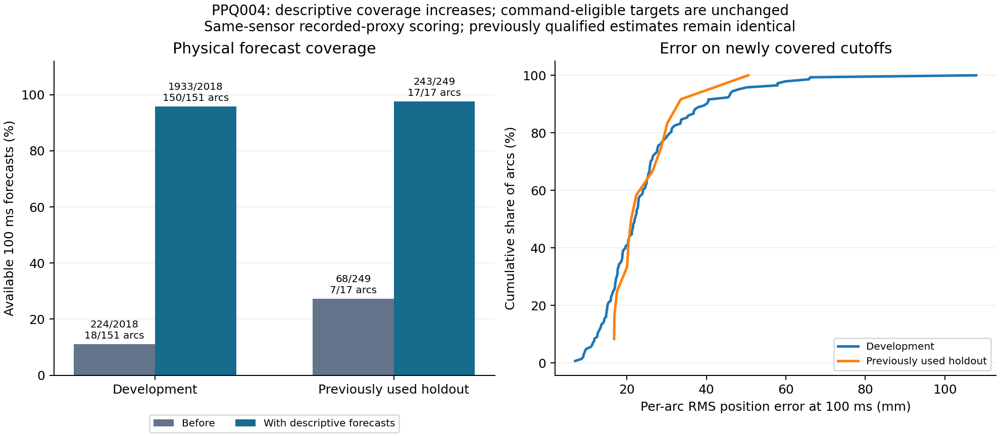

# Descriptive continuous-forecast follow-up

The managed CKF now continues descriptive physical tracking when shot
qualification withholds command authority. On the same PPQ004 holdout scoring
opportunities, availability increases from **68/249 to 243/249**, covering
**17/17 screened arcs instead of 7/17**. Every previously available qualified
estimate and every native command-eligible target is unchanged.



## What changed

The strict shot qualifier still rejects unsupported motion and retains its
rearm fence. While that shot is inactive, the existing ball tracker can now
assimilate source-qualified observations for a descriptive forecast. This uses
the same CKF, not a second ball tracker. On qualified shot acquisition, the
tracker is reset and seeded from the original qualified observations.

The managed coordinator enables this policy. Standalone pipelines retain their
strict default. Descriptive output is marked `UNCERTAIN`, carries
`DESCRIPTIVE_ONLY:<retained shot reason>`, includes conditional state covariance
and trajectory waypoints, and preserves source/frame/clock metadata. It has no
valid route target, no supported strike and no command eligibility. Both the
return selector and strike adapter explicitly reject descriptive-only input.

Innovation rejection, source identity, freshness, packet reconciliation,
one-shot command ownership and revocation safeguards remain active. Descriptive
tracking resets after a gap over 25 ms and requires six accepted observations
spanning at least 25 ms. A rejected current measurement is never advertised as
a newly measured posterior. The motion residual threshold was not raised.

## Results

These are predictions 100 ms after the current source sample, using the same
predeclared common free-flight propagation and measured-position proxy scoring.
They are not processing latency measurements. Query spacing remains 20 ms.

| Split | Before: available cutoffs | After | Before: covered arcs | After |
|---|---:|---:|---:|---:|
| Development | 224/2018 (11.1%) | 1933/2018 (95.8%) | 18/151 | 150/151 |
| Previously used holdout | 68/249 (27.3%) | 243/249 (97.6%) | 7/17 | 17/17 |

The holdout's six remaining missing cutoffs are descriptive warm-up. Development
retains 80 warm-up and five innovation-rejected cutoffs. They remain explicit
missing outputs, not zero-error observations.

| Newly covered cutoffs only | Cutoffs / arcs | Median per-arc RMS | 95th percentile arc RMS | Worst arc RMS |
|---|---:|---:|---:|---:|
| Development | 1709 / 143 | 22.04 mm | 47.88 mm | 107.89 mm |
| Previously used holdout | 175 / 12 | 21.69 mm | 41.19 mm | 50.53 mm |

An arc can contain both previously available and newly covered cutoffs; these
arc counts therefore cannot be added to the original arc counts. Error tails
remain material. Covariance is conditional on the model and is not a calibrated
bound for arbitrary non-ballistic motion. Added descriptive output does not
establish that every motion rejection was wrong.

The [parity audit](coverage-parity.json) compares all 24,490 query cutoffs across
the three complete takes, including all four plane queries at each cutoff:

* Zero changes to any previously available qualified position, velocity, spin
  or shot generation.
* Zero changes to native target-valid flags or supported target positions and
  arrival times.
* Zero changes to the original 100 ms scored errors.
* Every added available forecast explicitly has a descriptive-only reason.

Consequently, **command coverage is unchanged**. The primary x=0.15 m native
contact comparison still has only one paired holdout arc. This change improves
continuous observation and simulation diagnostics; it does not solve command
recovery or prove improved racket interception.

Across the expanded common support, 100 ms holdout comparisons with main have
bootstrap difference intervals that include zero. These have different support
from the original comparison and are not evidence that the CKF became more
accurate. Previously supported CKF estimates are exactly unchanged.

## Verification

* Actual ROS planner executable built successfully.
* **187 tests in 12 selected ROS/native CTest groups passed**, including
  reacquisition counterexamples and spin, integrated return, PR64 regressions,
  strike adapter, Runner pre-engagement revocation, coordinator, PPQ004 state
  contract, real ROS integration, flight prediction, contact corroboration and
  transport serialization. XML receipts are in `tests/`.
* The new ROS regression checks descriptive state publication and denied strike
  support in fixed, per-ball and stable-per-ball plane modes.
* All 13 comparison controls passed, including causal prefix invariance and
  quaternion sign equivalence. The standalone comparison build's five native
  test groups passed as well; these overlap the scoped native coverage.
* All six complete recording/adapter runs exited successfully. Inputs and
  outputs are hash-bound; the scorer verifies original positions/timestamps.
* The full-recording command/state parity audit passed. Packaged compressed
  artifacts were checked against the original uncompressed hashes.

The full 166-test application campaign, MuJoCo execution, independent truth
qualification and physical deployment were not rerun or claimed here. These
recordings and screened arcs were already used previously; they are not a new
blind holdout. Original results remain under `../comparison/` and earlier
partial recovery evidence remains under `../recovery-progress/`.

## Source and reproduction

* Runtime implementation: [ae95a3c](https://github.com/timothyypark/HOPE/commit/ae95a3c3d24e6fe3f520783db512abdecffaa520).
* Final feature branch: [feature/descriptive-continuous-forecast](https://github.com/timothyypark/HOPE/tree/feature/descriptive-continuous-forecast).
  Later commits add ROS tests and documentation only; `source-freeze.json`
  verifies that runtime sources are unchanged from the replay pin.
* Prereplay experiment contract: [ff1017e](https://github.com/timothyypark/HOPE/commit/ff1017e).
* Comparison, parity auditor and plotting code:
  [analysis/descriptive-forecast-coverage](https://github.com/timothyypark/HOPE/tree/analysis/descriptive-forecast-coverage/analysis/ppq004_accuracy).

Follow the original [reproduction instructions](../comparison/REPRODUCE.md) with
these substitutions: use this folder's replay and annotation files, and pin
the candidate V2 checkout to `ae95a3c3d24e6fe3f520783db512abdecffaa520`.
The original main pin remains `01de418c146cf3f2d2dba32e63b425f01c8a7f19`.
For a fresh run, supply the committed follow-up contract explicitly:

```bash
python analysis/ppq004_accuracy/run.py \
  --contract analysis/ppq004_accuracy/descriptive-contract.json \
  --main /tmp/accuracy-main --v2 /tmp/descriptive-v2 \
  --build /tmp/descriptive-build --prepared /tmp/accuracy-prepared \
  --output /tmp/descriptive-replay
```

Use the unchanged `score.py` with that replay and a new output directory.
Run `compare_coverage.py` with `--baseline`, `--candidate`, `--baseline-scores`,
`--candidate-scores` and `--output` to reproduce the parity audit. Retained
`replay/receipt.json`, `inputs/contract.json`, `scores/results.json` and raw scored
CSV rows bind the conclusions to the exact invocation. `SHA256SUMS` inventories
this package and `compression.json` records original uncompressed hashes.

For the ROS checks, source ROS Jazzy and the matching `hope_msgs` installation,
configure this feature's `hope_ws/src/hope_planner_cpp` with CMake and
`BUILD_TESTING=ON`, and build the planner plus the 12 test targets named in
`logs/ros-tests.log`. Their names correspond directly to CMake targets. The
selected checks are deliberately scoped; passing them is not reported as a
complete application deployment qualification.
