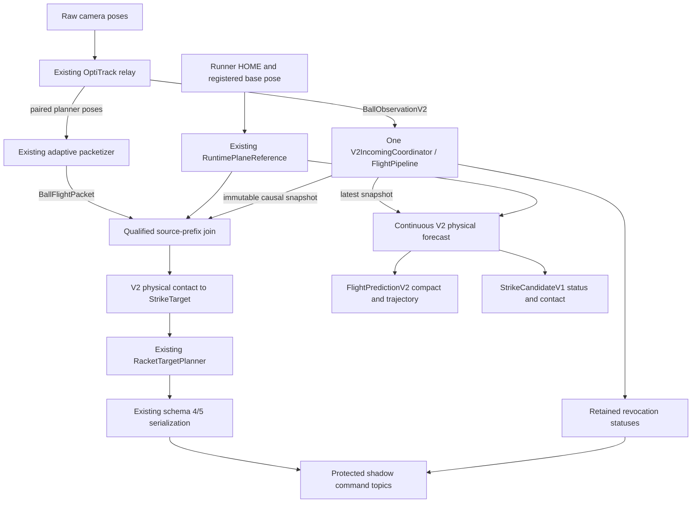

# Shared V2 incoming prediction: architecture, contracts and verification

**Implementation is committed and shadow-only. Software qualification failed.**
The required original `review_chain_300_12_unknown` coverage failure remains open,
as do additional availability/freshness failures. Gates J and K do not pass.
Neither Track A software completion nor Track B readiness is claimed.

The full frozen invocation tested `369dd6cf6bfbf12ce2f4cd87223570fd7ee008df`.
The subsequent `f015e0e` commit changes only a remaining camera fixture, its
contract and documentation; runtime C++ and Runner sources are identical.
Its separate focused verification is **13/14**, with the failed observer
assertion retained. The evidence records exact source/configuration/binary hashes.

[Portable evidence and verification instructions](https://github.com/timothyypark/HOPE/tree/evidence/v2-incoming-qualification-20261029)
include every retained failed/interrupted invocation and all final trials.

## Source and scope

The implementation branches from PR85 at
`4d2247c69100f1e5416a8f42468b4d67418c45fb`. The selected upstream is
`hitchopen/HOPE:nightly_built`, initially and subsequently checked at
`91aecabfd44cb258ac998158e724be9017d883a7`. PR85 remains separate. The new branch is
`timothyypark/HOPE:feature/v2-incoming-validity-continuous-dropin`.
The `timothyypark/nohope` fork remains at `96e71c1adb217d14b925681173cebe00d8427f21`. GitHub identifies its parent as `dongc1/nohope`; direct Git access returned 403 and the parent commit API returned 404, so its current upstream head could not be independently refreshed. The inspected fork does not own the HOPE ROS package integration in this plan; no change is required there.

Legacy remains the default. The new backend accepts only shadow outputs and
rejects output remapping. Live deployment and robot actuation have not been
authorized or tested. The outgoing RacketTargetPlanner, RuntimePlaneReference,
existing packers, policy ONNX/yaml artifacts and managed deployment profiles
remain unchanged. The only Runner behavior change is an explicit, default-off
pre-engagement revocation option, justified by a reproduced production failure.

## Actual architecture



PlannerNode uses its existing solver thread. Typed observations and HOME/base
updates are serialized through the authority lock. There is no second live
estimator for commands: bounded checkpoints reconstruct an immutable copy at the
actual packet cutoff, replaying only the already-observed causal suffix. Packet
epochs and physical generations are different identities. Reconciliation also
checks producer/session/frame/sequence and exact acquisition samples; the ROS
ingress verifies the packet payload hash. A packet quaternion cannot qualify
spin that the typed observation marked unknown.

One waiting packet receives priority over replaceable continuous work. The owner
keeps at most 512 observations, eight checkpoints, 128 claimed flight identities
and 64 queued status records. Overflow of the status queue latches fail-closed.
The optional actual-stage trace is a 65,536-entry bounded ring; qualification
rejects truncated traces. Ordinary observation updates preserve pending authority;
physical/contact, HOME, source and deadline changes retire obsolete workers.
The authority lock spans final publication, so invalidating evidence and command
publication have an explicit order.

## Consumer and plane contract

The existing HOME selector supplies `x_hit = reference_x + policy_plane_offset`.
Fixed previews use HOME immediately. Per-ball and stable-per-ball previews are
tentative until the existing packet commitment invokes the selector. All later
continuous revisions of that flight reuse the same frozen selected plane.
Continuous observations cannot create a second command for a claimed flight.

All outputs are under `/hope/shadow/v2_incoming/`:

| Suffix | Interface | Delivery/use |
|---|---|---|
| `command_flat` | Existing Float64MultiArray schema 4/5 | One valid command per committed flight; identity-bearing invalid packet on revocation |
| `command` | Existing RacketCommand | Existing typed valid command output |
| `hit_plane` | Existing managed plane receipt | Existing packetizer/plane contract |
| `prediction` | Unchanged FlightPredictionV2 | Latest compact state/events, reliable depth 1 |
| `trajectory` | Unchanged FlightPredictionV2 | Full waypoints, best effort depth 1, default maximum 50 Hz |
| `candidate` | New StrikeCandidateV1 | Latest contact/status, reliable depth 1 |
| `revocation` | StrikeCandidateV1 | Separate retained status stream, reliable transient-local depth 64 |
| `diagnostics` | Existing diagnostics interface | Explicit V2 counters and reference/source status |

Disabling full trajectory output does not change estimation or commands. Disabling
continuous output also preserves command/revocation behavior. With no command
packets, continuous estimation and tentative candidates continue independently.
The FlightPredictionV2 schema and original route-target semantics are preserved;
the companion's contact-support fields describe managed-plane strike eligibility.

Consumers must check session, source clock/mapping, frame/registration, ball,
physical generation, HOME/plane identity, context and prediction revision. Never
replace a newer status with an older revision. Retain per-flight revocations even
when the latest candidate belongs to a subsequent flight. Check source and contact
deadlines at use time; receipt time is not a replacement source timestamp.
`runner_commitment_state=UNKNOWN` is intentional: shadow reception is not evidence
of engagement. Event evidence identifies the observed causal ledger, including the
new contradictory evidence on a revoked candidate. A revocation identifies the
original candidate source/revision being withdrawn; its event confirmation times
can be newer than that source. It must not be interpreted as a new forecast from
the old source prefix. An accepted command retains its original absolute contact
deadline; newer healthy observations can support its flight without rewriting
that command timestamp. Source loss still revokes its pending authority.

| Status | Meaning |
|---|---|
| ACQUIRING | Insufficient estimator observations |
| UNAVAILABLE | Missing support or uncertain ordering/registration |
| SUPPORTED | Physical incoming contact established; command authority is separate |
| INELIGIBLE | Supported evidence violates the return/contact rules |
| REVOKED | Previously supported authority withdrawn |
| EXPIRED | Source or contact deadline passed |

`physical_state_available`, `strike_contact_supported` and `command_eligible`
are independent. Missing game history does not itself forbid a supported local
return. Measured-zero spin remains distinct from unknown spin. Confirmed terminal
events, a second receiver bounce before contact, a missing required bounce or a
crossing after physical termination cannot authorize a new command. Uncertain
ordering remains unavailable. A later bounce after an earlier valid contact does
not retroactively change the event order at that source cutoff.

## Runner lifecycle and limit

The original PR85 production policy can engage a retained target after an invalid
packet. The default-off option preserves this original behavior. With
`--planner-preengagement-revocation`, schema-4/5 invalid input with matching
HOME/flight and a revision newer than that flight's valid command permanently
vetoes engagement for that flight. The final receiver guard locks through the
policy's engagement transition. HOME comes only from the local production policy;
cross-session packets cannot reset authority or consume transport sequence space.
The bounded 256-flight veto ledger latches closed on overflow until a new HOME.
Delayed per-flight revocation remains effective after newer unrelated status.

The software lifecycle probe runs actual PpPolicy and unchanged ONNX inference
with the checked-in compatible training checkpoint and real 50 Hz ticks. It
compares PR85 headers, the new option disabled and enabled for schemas 4 and 5.
It covers invalidation before a valid command, after the policy sees a pending
command, after engagement, and reordered unrelated revocation. The earlier
model_21800 attempt failed shared-HOME artifact validation and is retained.

After engagement, the policy deliberately continues the active swing. Neither
the planner nor this option guarantees cancellation of an engaged swing. Network
delivery and the actual deployed ONNX identity remain deployment concerns; the
software test does not demonstrate HAL transport or physical motion.

## Required validity matrix

| Cases | Test evidence |
|---|---|
| IV01, IV21 | V2StrikeAdapter.PhysicalSupportAndRouteTargetAreDistinct; managed ROS valid flights |
| IV02–IV09 | Adapter absent/forbidden/ambiguous/terminal tests and inherited physical-return regressions |
| IV10–IV11 | ContactCorroboration isolated rejected outlier, genuine high-innovation impact, restored suffix; inherited close/sparse/double contacts |
| IV12 | Coordinator source fault/expiry, explicit expiry without prior candidate; every incoming producer-chain flight |
| IV13 | Coordinator.ConfirmedSecondBounceRetiresPreviouslySupportedWorker; authority invalidation before delayed publication |
| IV14–IV15 | Actual production Runner before/after/disabled/enabled lifecycle comparison; native atomic engagement ordering |
| IV16 | Existing reacquisition regressions and ten-flight incoming producer chain with distinct stable generations |
| IV17 | Coordinator HOME update tests and existing managed plane tests |
| IV18–IV19 | ROS continuous after one-shot and without packets, output-disabled commands, immutable-flight campaign gates |
| IV20 | Coordinator revision retirement; Runner stale/cross-session/late-valid/reordered-veto regressions |
| IV22 | Typed spin authority and inherited spin suites; zero/unknown campaign profiles |
| IV23 | Coordinator packet-vs-continuous exact cutoff state/covariance/contact equality; existing source-cutoff parity |
| IV24 | Actual fixed/per-ball/stable-per-ball ROS and receiver tests plus 27 exact outgoing parity combinations |

## Complete frozen verification

All listed ROS/C++ tests ran in this cloud environment, using ROS Jazzy on
Ubuntu 24.04.5, GCC 13.3 and Fast DDS 2.14.7. The parent CPU quota is four CPUs
with five visible CPUs. Tests used localhost and the default transport mode.
No timed trial overlapped compilation or archival. Between the two campaigns,
665 completed receipts were losslessly compressed with verified decompressed
hashes; no trial was interrupted or retried. The exact pause is retained.

| Check | Result |
|---|---|
| Native C++ | 25/25 groups pass |
| ASan/UBSan with leak detection | 25/25 groups pass |
| Independent outgoing numerical reference | 144/144 pass |
| Current and historical legacy parity | 701/701 each pass |
| V2 source-cutoff comparison | 789 checked: 782 bit-exact, seven pinned conservative one-cutoff delays; exact next-cutoff reconvergence |
| Selected ROS packages, all 159 registered groups | Planner 128/130, messages 2/2, bringup 25/27 |
| Instrumentation on/off comparison | 8/8 pass |
| Existing-backend repeated campaign | **152/160 pass; eight failures** |
| Incoming repeated campaign | **83/90 pass; seven failures; 894/900 commands** |
| Actual PpPolicy/unchanged ONNX Runner comparison | 24/24 expected outcomes pass |
| Installed shadow launch | Pass; correct nodes/topics, no HOME/camera/actuation input |
| Source commit and worktree integrity | Pass throughout the complete invocation |

The raw aggregate exit is **1**, and is preserved. Bringup flake8/pep257 are
inherited: 3,222 versus baseline 3,232 flake8 findings and 37 versus 37 pep257
findings, with no added findings. The scoped ROS audit also fails for the two
planner cases below, independently of lint.

The Runner production entry point separately passed a syntax check. The real
policy and unchanged compatible ONNX model ran in memory at 50 Hz; the full
hardware executable was not linked/run against HAL. Launch-only smoke tests
observe the node/topic graph but no candidate without inputs; forecast-delivery
evidence comes from the actual producer-chain tests.

### Full ROS failures

- `incoming_chain_300_stable_per_ball_zero`: 471/484 continuous epochs (97.314%),
  nine packets and nine commands for ten flights. Six eligible flight-5 epochs
  have no relay receipt; the packetizer emitted no flight-5 packet. The source
  measured 299.163 Hz with an 8.55 ms maximum acquisition gap. Later relay receipts
  reached 25.94 ms source age. Candidates remained tentative and no command was
  authorized for the missing flight. The pause's root cause is unresolved.
- `reacquisition_chain_300_ON_REFRESH_zero`: 151/161 epochs (93.7888%). A 29 ms
  source gap was followed by artificial catch-up captures in the separate camera
  fixture. That source is corrected after the campaign, as described below.
  Stage accounting was disabled in this full-suite profile; a specific worker
  fate is not retroactively inferred for each missing epoch.

### Original four required failure profiles

| Profile | Full ROS invocation | Applicable repeated results |
|---|---|---|
| `base_yaw_chain_150_0` | 39/41, pass | Not part of the original 160-run matrix |
| `review_chain_300_12_unknown` | 40/40, pass | **4/5; repetition 2 fails at 36/39** |
| `review_chain_150_12_zero` | 20/20, pass | 5/5 pass |
| `review_refresh_300_10_unknown` | 160/160, pass | 5/5 pass |

The user's required closure of all four is **not achieved**. Historical failures
remain published; neither focused passing runs nor pooled averages erase them.

### All failed repeated trials

| Existing-backend profile | Repetition | Coverage | Actual first observed losses / other failure |
|---|---:|---:|---|
| `review_chain_300_10_known` | 2 | 137/148 | 10 pending jobs superseded/closed; 1 worker rejection |
| `review_chain_300_12_unknown` | 2 | 36/39 | 3 pending jobs superseded/closed |
| `review_refresh_150_12_known` | 3 | 10/11 | 1 pending job superseded/closed |
| `review_refresh_300_12_known` | 3 | 33/36 | 2 pending jobs superseded/closed; 1 worker rejection |
| `reacquisition_chain_300_FOLLOW_POSE_unknown` | 4 | 151/160 | 4 pending jobs superseded/closed; 5 worker rejections |
| `review_chain_300_12_known` | 4 | 26/32 | 4 pending jobs superseded/closed; 2 worker rejections |
| `reacquisition_chain_300_ON_REFRESH_zero` | 5 | 159/159 | AssertionError: ('A never acquired', 5) |
| `review_chain_300_12_zero` | 5 | 33/35 | 2 pending jobs superseded/closed |

One failed trial contains a 62.708 ms outgoing-solve interval. These stages measure
wall/steady time, so they do not distinguish computation from blocking or scheduling.
The `A never acquired` assertion in repetition 5 is a periodic-status observer
assertion: actual pipeline stages contain three acquisition records for that A.
Its failed verdict remains retained, together with this more precise diagnosis.

| Incoming profile | Repetition | Commands / packets | Failed condition |
|---|---:|---:|---|
| `incoming_chain_300_per_ball_zero` | 1 | 9 / 10 | PACKET_OBSERVATION_PREFIX_MISMATCH |
| `incoming_chain_360_per_ball_unknown` | 1 | 9 / 9 | One flight produced no packet |
| `incoming_chain_150_per_ball_unknown` | 3 | 9 / 10 | PACKET_OBSERVATION_PREFIX_MISMATCH |
| `incoming_chain_150_per_ball_zero` | 4 | 9 / 9 | One flight produced no packet |
| `incoming_chain_150_stable_per_ball_zero` | 4 | 9 / 10 | PACKET_SOURCE_EXPIRED_OR_UNQUALIFIED |
| `incoming_chain_360_stable_per_ball_zero` | 4 | 9 / 10 | PACKET_OBSERVATION_PREFIX_MISMATCH |
| `incoming_chain_300_fixed_unknown` | 5 | 10 / 10 | Forecast publication completion age 54.731 ms |

All 90 incoming trials met the continuous coverage threshold (minimum 95.7821%).
Six failed one-shot command coverage/flight identity; one failed publication age.
The latter completed one forecast publication at 54.731 ms, while its commands
stayed within 13.256 ms. Across all incoming trials, command publication completed
within **17.579 ms**, worst command decoder P95 was **14.095 ms**, and maximum
source-expiry notification delay was **25.660 ms** after its deadline. Maximum
observed planner resident high-water memory was 52,704 KiB.

Across every existing-backend trial, including failures, minimum coverage was
81.25%, maximum observed command publication age was 24.882 ms and worst observed
matching-decoder P95 was 7.339 ms. Missing opportunities remain failed coverage;
no latency is invented for work that never published. Complete raw stage ledgers
and per-trial metrics are in the evidence, including the difference between source,
relay, planner, worker, publication and observer loss.

## Post-campaign fixture correction

The integrated and incoming camera fixtures already resumed paced acquisition
after overruns. The separate reacquisition camera still emitted overdue nominal
ticks as artificial rapid captures. Commit `f015e0e` applies the same SourceCadence
helper and health gate to that third source. Every actual offered observation,
all ten A/B rounds, fault injections and eligibility windows remain counted.
Actual mean source rate must reach 95% of requested, and minimum spacing must
be at least half a period; maximum lateness and missed nominal ticks are recorded.
These are aggregate/minimum-spacing checks, not a guarantee of no long source gap.

A predeclared development comparison injects a 40 ms acquisition pause at the
same source index. The original source failed at 128/161 coverage (79.5031%) and
emitted catch-up intervals as short as about 0.12 ms. Paced resumption passed at
143/146 (97.9452%), resumed about 3.33 ms spacing and measured 298.705 Hz. This
corrects artificial exposures; it does not establish that runtime gaps are solved.
Both trial scripts, hashes, raw records and outcomes are retained.

The committed correction passed scope/accounting pytest **10/10**. All fourteen
registered consumers then ran once with actual-stage accounting: **13 passed,
one failed** (`reacquisition_delayed_150`, `A never acquired`, round 1). That source
suffered a 322 ms scheduling gap and offered six A exposures. The actual pipeline
records acquisition at the last A exposure; the periodic status observer missed
the short acquired interval. Command coverage was 100%. The test remains failed,
with the actual transition evidence preserved. These focused runs receive no
replacement qualification credit. Runtime sources and tested binaries are unchanged.

## Retained earlier invocations and diagnostics

| Invocation | Retained outcome |
|---|---|
| 01, `a91ec84` | Interrupted to correct reordered Runner revocation; original receipts retained |
| 02, `d176280` | Missing standalone ROS include and outdated exact V2 parity assumption; corrected explicitly |
| 03, `5eeba2c` | Two incoming profiles offered balls before HOME discovery; explicit readiness barrier added, with all ten flights retained |
| 04, `ed4a150` | Full ROS included outdated scope assertions and a 360 Hz profile with 546/590 coverage and 9/10 commands; stopped before campaigns |
| 05, `290f7c4` | Native/sanitizer/parity/Runner pass; planner 129/130, old campaign 157/160, incoming 89/90; complete failed invocation retained |
| 06, `369dd6c` | Complete failed invocation and every declared trial described above |

A 117.596 ms relay callback in invocation 04 remains unexplained. Ten GC trials
and twenty synchronous/asynchronous diagnostics did not reproduce it. Three
asynchronous trials exposed relay-to-planner loss with depth-one qualified writers;
matching both writers to the bounded depth-eight input history corrected that
transport weakness. Ten subsequent asynchronous diagnostics passed. Legacy
rate-limited output histories remain one.

The integrated-source controlled pause comparison changed 35/41 to 35/36 after
removing catch-up captures. Later 30-trial transport and 12-trial publication-mode
comparisons passed 28/30 and 10/12 respectively. Explicit loopback UDP also had a
332.6 ms source publication call with only 0.164 ms thread CPU time. Shared memory,
GC and publication mode are not established as the cause or cure. Invocation 05's
parent monitor showed no quota-throttling increments around its specific long
gaps. No diagnostic retry receives qualification credit.

Large raw receipts and older compiled artifacts were losslessly retained with
original byte counts/SHA-256 and verified decompression before removal. Portable
evidence includes all raw receipts (some as `.gz`) and retention inventories;
compiled binaries/dependencies are excluded, with their hashes recorded.

## Accuracy and acceptance decision

No independent held-out annotated ball flights with source-clock, registered
frame and authoritative-plane receipts were located in either repository.
**Measured physical prediction accuracy remains NOT_RUN.** Existing physics-fit
or robot-motion recordings are not substituted for held-out ball-flight truth.

The incoming campaign retained 38,242 synthetic candidate comparisons against
independent DOP853 truth. Position-error norm P50/P95/max was approximately
0.00000198 / 0.001994 / 0.052119 m; absolute arrival-time error was
0.001759 / 0.241353 / 1.292432 ms. These controlled 10 m/s zero/unknown-spin
profiles assess numerical behavior, not real-world ball-return accuracy.

| Gate | Decision and evidence |
|---|---|
| A — Physical validity | Tested adapter/coordinator/ROS invalidity cases pass; no unsupported new command was observed |
| B — Bounce correctness | Failing-before isolated-outlier case fixed; genuine/high-innovation/sparse/double/restored contacts preserved |
| C — Invalidation | Authoritative generation/revision/HOME/source fences and atomic publication tests pass |
| D — Recovery | Native and managed ROS recovery evidence passes; availability/oracle failures remain under J/K |
| E — Plane selection | Existing plane implementation unchanged; fixed/per-ball/stable-per-ball tests pass |
| F — Racket planning | 27 exact downstream/serialization parity combinations pass; solver unchanged |
| G — Schema compatibility | Actual schema-4/5 producer/receiver and policy tests pass |
| H — One-shot lifecycle | Identity/deduplication/immutability tests pass; lost opportunities remain failures under J |
| I — Continuous capability | Independent output and coexistence tests pass; 30 ms completion target fails once under J |
| **J — Performance** | **FAIL:** coverage losses and 54.731 ms forecast publication |
| **K — Full regression** | **FAIL:** required original profile remains open; scoped failures and inherited lint disclosed |
| L — Runner invalidation | Pass only for the tested compatible policy with explicit opt-in; default-off behavior and active swing continuation preserved |

**Go/no-go:** downstream compatibility is demonstrated in the tested software.
Track A is not software-qualified, Track B is not declared ready for future
continuous racket planning, and live adoption is blocked. The next work is to
resolve the measured delivery/worker availability and publication stalls, correct
the transient-status lifecycle oracle using authoritative evidence, and pass a
new complete frozen qualification without weakening validity, freshness or
coverage. Deployment additionally needs the actual deployed artifact/receiver
configuration, hardware transport and physical validation. A new racket planner
or active mid-swing update/cancellation system is not required for this milestone.

## Review and reproduction

The source branch contains small commits grouped by contact correctness, adapter,
coordinator, managed ROS integration, Runner veto, producer-chain qualification
and the separately demonstrated test/transport corrections. The scope manifest
lists each changed path and its purpose. Existing outgoing solver/packer/plane
sources and policy artifacts are byte-pinned in the scope audit.

The opt-in installed launch is `v2_incoming_shadow.launch.py`. It requires
`session_id`, registered `frame_id` and ball `calibration_id`, plus the numeric
`base_calibration_id` and `base_world_id`. `plane_mode` accepts `fixed`, `per_ball`
or `stable_per_ball`; the defaults keep legacy activation unchanged. The relay
must publish qualified `BallObservationV2` and paired full-rate planner poses
on `/poses/planner_full`, with `input_history_depth=8` and the same ball
registration. The base relay and Runner HOME must carry matching actual
registration receipts. These values are not supplied by the launch. The
qualification harness uses explicitly synthetic receipts, never substitutes
those for real registration, and sends commands only to protected shadow topics.

For reproduction, check out the tested source commit in a separate clone and
source ROS Jazzy. The repository entry point is:

```bash
bash hope_ws/src/hope_planner_cpp/scripts/flight_prediction_validation/verify_integrated.sh /absolute/new/evidence-directory
```

The retained wrapper records the selected-upstream lint baseline build, original
Runner source checkout, ONNX Runtime 1.19.2 location and policy Python dependencies.
The final run uses the same entry point with one recorded storage-only hook:
after sanitizer tests finish and before ROS/timing tests begin, it losslessly
retains sanitizer binaries/objects with verified hashes. No timing trial runs
concurrently with compilation or archival. Source hashes, exact commands,
per-gate exits, middleware/library versions and parent cgroup observations are
retained. A different host or run produces new empirical evidence; it cannot
replace these receipts or establish a hard-real-time guarantee.
