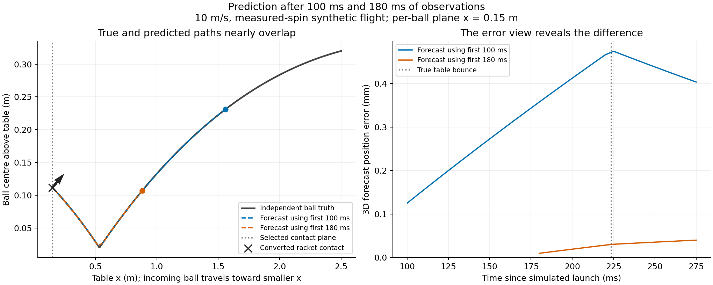
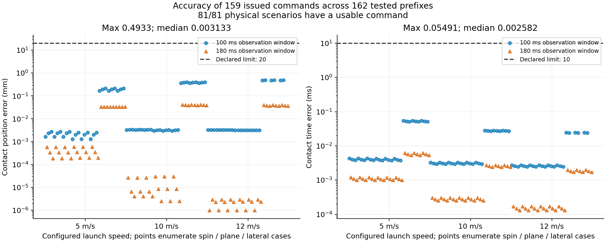
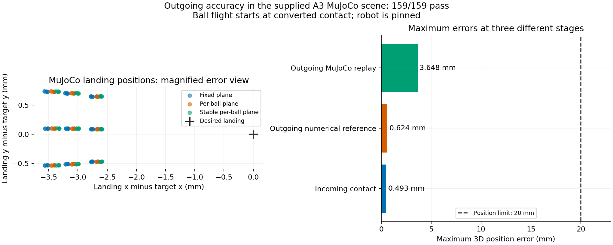

# Prediction accuracy and local simulation

[Run it yourself: native C++, Python, ROS 2 and MuJoCo](https://github.com/timothyypark/HOPE/blob/feature/v2-incoming-validity-continuous-dropin/hope_ws/src/hope_planner_cpp/docs/v2_local_simulation_guide.md) · [Download graphs and standalone HTML](graphs.zip) · [Numeric errors CSV](plots/errors.csv) · [Metrics and source hashes](plots/summary.json)

Download `graphs.zip`, extract it and open `index.html` for an offline report. Each graph is also provided as PNG and SVG. GitHub displays the figures below; its HTML source preview is not the rendered report.

## How more observations change the forecast

The true and predicted paths nearly overlap, so the right panel magnifies their spatial error. In this measured-spin example, using 180 ms of observations reduces the maximum forecast error from **0.4744 mm** to **0.03967 mm**, compared with the 100 ms prefix. The vertical dotted line in the trajectory view is the selected contact plane; the arrow shows the racket normal. This is one noiseless synthetic flight, not a general convergence claim. Time is measured from simulated launch, not net crossing, and is not processing latency.

## Contact position and time

Maximum contact-position error is **0.4933 mm**; maximum contact-time error is **0.05491 ms**. Both panels use logarithmic error axes and show the predeclared limits. The points include all 159 issued commands. Three early uncertain prefixes abstained; their errors are not plotted as zero. All 81 physical scenarios have a supported command at a declared cutoff.

## What MuJoCo predicts for the return

The left panel magnifies landing error around the target: these returns land approximately 2.6–3.6 mm short along x. Maximum 3D landing error is **3.6477 mm**, within the declared 20 mm criterion. The right panel compares maximum position error at three different stages. All **159/159** supplied-scene replays pass their landing/net checks.

The robot is pinned. MuJoCo starts the ball at the converted contact using reconstructed outgoing velocity; it does not simulate a policy-driven swing or an incoming ball striking a moving racket. A live ROS/MuJoCo bridge and dynamic contact loop remain additional integration work, described in the guide.

## Interpretation and validation

The data is synthetic and noiseless. Unknown-spin cases use a zero-spin plant with withheld orientation. These results do not establish physical accuracy or reliable command delivery: the preceding qualification still has 899/900 usable incoming commands and unresolved historical delivery losses.

The new plotting workflow ran without ROS Python dependencies. All 162 conversion checks and 159 MuJoCo cases passed; command and waypoint CSVs are byte-identical to the earlier retained receipts. A fresh 150 Hz/fixed-plane/zero-spin ROS chain passed with ten commands. Focused scope/audit checks also passed. Production prediction, command eligibility, expiry and racket planning were unchanged.

Source: [`979f9aa`](https://github.com/timothyypark/HOPE/tree/979f9aa). [Verification comparisons](verification.json), [raw receipts](receipts.tar.gz), [per-file hashes](receipt-inventory.json) and [build provenance](provenance.json) are retained. This is a focused visualization/test-harness update, not a replacement 250-trial qualification.
